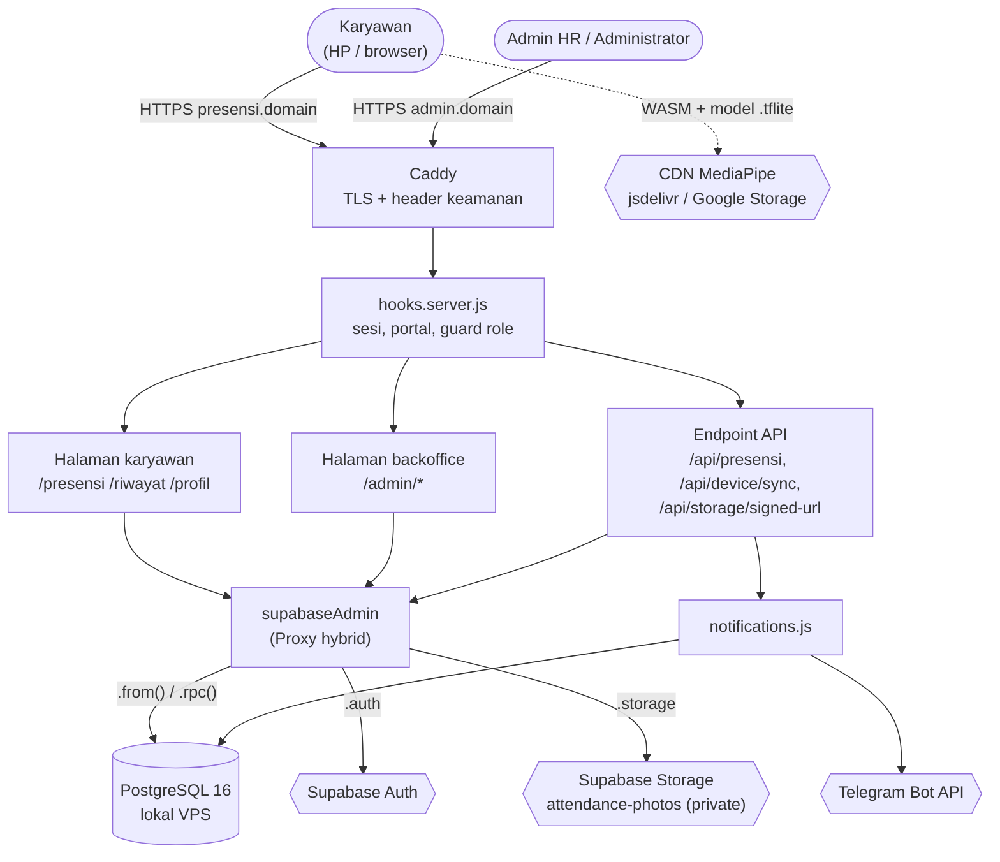

# Arsitektur

Sistem ini adalah **monolit SvelteKit**: satu proses Node.js melayani halaman (SSR + hidrasi Svelte), form action (`+page.server.js`), dan endpoint JSON (`+server.js`). Proses berjalan di container Docker pada VPS, di belakang **Caddy** yang menerbitkan sertifikat HTTPS otomatis untuk dua domain. HTTPS wajib karena browser hanya mengizinkan kamera dan geolocation pada *secure context*. Header `Permissions-Policy: camera=(self), geolocation=(self)` dipasang di [`Caddyfile`](../../Caddyfile).

Pembagian kerja **browser dan server** adalah inti desainnya. Browser karyawan menyalakan kamera depan, menjalankan model **MediaPipe BlazeFace** (WebAssembly, GPU dengan fallback CPU) di setiap frame, membaca GPS, dan mengompres foto menjadi JPEG lebar 480px. Server **tidak mempercayai** jam dan lokasi dari klien. Server memakai `new Date()` miliknya sendiri (zona `Asia/Jakarta`) untuk tanggal kerja dan status, menghitung jarak Haversine ke lokasi kerja, memeriksa anomali GPS, dan mencocokkan perangkat.

State tersimpan di tiga tempat:

1. **PostgreSQL 16 lokal di VPS** untuk semua tabel operasional (`profiles`, `attendances`, `settings`, `user_devices`, `notifications`, `audit_logs`, dan lainnya), diakses lewat `pg`.
2. **Supabase Auth** untuk akun, password, dan sesi (cookie `sb-*-auth-token` melalui `@supabase/ssr`).
3. **Supabase Storage** untuk foto presensi di bucket private `attendance-photos` dengan path `{user_id}/{yyyy-mm-dd}/{in|out}.jpg`. Foto dibaca lewat *signed URL* yang berlaku 60 detik.

## Komponen

- **Caddy (reverse proxy)**: TLS otomatis, kompresi zstd/gzip, header keamanan (HSTS, nosniff, Permissions-Policy). Lihat [deployment-ops](modules/deployment-ops.md).
- **`hooks.server.js` (gerbang)**: membuat klien Supabase per request, memverifikasi user, memuat profil, menentukan portal dari hostname, lalu menerapkan aturan redirect per role. Lihat [auth-routing](modules/auth-routing.md).
- **Halaman karyawan** (`/presensi`, `/riwayat`, `/profil`, `/ganti-password`). Lihat [presensi](modules/presensi.md) dan [employee-self-service](modules/employee-self-service.md).
- **Halaman backoffice** (`/admin/*`). Lihat [backoffice](modules/backoffice.md).
- **Endpoint API** (`/api/presensi`, `/api/device/sync`, `/api/storage/signed-url`, `/api/resolve-maps`). Lihat [api.md](api.md).
- **`supabaseAdmin` (lapisan data)**: sebuah Proxy yang mengarahkan `.from()` dan `.rpc()` ke PostgreSQL lokal, sedangkan `.auth` dan `.storage` ke Supabase Cloud. Lihat [data-access](modules/data-access.md).
- **Notifikasi**: tabel `notifications` dan Telegram Bot API. Lihat [notifications](modules/notifications.md).

## Diagram Sistem

## Data Flow (presensi masuk)

1. **Browser menyiapkan data**: kamera, deteksi wajah per frame, GPS `watchPosition`, kompresi `canvas.toBlob('image/jpeg', 0.65)`. Lihat [`presensi/+page.svelte`](../../src/routes/presensi/+page.svelte).
2. **`POST /api/presensi` berupa multipart**: `type`, `photo`, `lat`, `lng`, `accuracy`, `timestamp`, `is_mock`, `device_id`, `device_name`, `browser`, `os`.
3. **Gerbang**: `hooks.server.js` memvalidasi sesi. Endpoint memastikan `role === 'karyawan'` dan akun aktif.
4. **Pemeriksaan anomali GPS**: mock provider, akurasi kurang dari 1,5 m (mencurigakan), akurasi lebih dari 1.500 m (sinyal BTS), serta selisih timestamp GPS dengan jam server lebih dari 30 detik.
5. **Pemeriksaan perangkat**: tanpa perangkat utama, request ditolak (403, `needsRegistration`). Perangkat asing dicatat `is_trusted=false` dan memicu notifikasi ke HR dan Telegram.
6. **Jarak**: target memakai `profiles.work_lat/lng/radius` bila diisi, dengan fallback ke `settings.office_*`. Jarak dihitung dengan `calculateDistance()` (Haversine).
7. **Upload foto** ke Storage `attendance-photos/{uid}/{tanggal}/in.jpg`.
8. **Simpan**: `attendances` di-insert atau di-update dengan status, `late_minutes`, jarak, flag, dan perangkat. `audit_logs` dicatat (`check_in`).
9. **Respons JSON** berisi status, menit terlambat, jarak, dan pesan dalam Bahasa Indonesia. UI lalu mengunci form.

## Keputusan Desain Penting

- **Waktu dari server, bukan dari HP.** Jam di HP bisa diubah karyawan. Tanggal kerja dihitung dengan `Intl.DateTimeFormat('en-CA', { timeZone: 'Asia/Jakarta' })` dari jam server.
- **AI di sisi klien.** Deteksi wajah (bukan pengenalan identitas) berjalan di browser, sehingga server tidak butuh GPU dan biayanya nol. Kekurangannya, deteksi di klien bisa diakali oleh orang yang paham teknis. Karena itu bukti foto, GPS, perangkat, dan audit tetap disimpan di server.
- **Tandai, jangan blokir.** Untuk GPS dan perangkat asing, presensi tetap diterima tetapi ditandai. Pilihan ini mencegah karyawan jujur gagal absen karena GPS buruk, dan keputusan akhir ada di HR.
- **Service key hanya di server.** Pembuatan akun memakai `auth.admin.createUser` di server route. Key rahasia tidak pernah dikirim ke browser.
- **Administrator tunggal dijamin database.** Ada partial unique index dan trigger `protect_administrator_profile`. Penggantian administrator hanya bisa lewat fungsi atomik `rotate_administrator()` yang dipanggil dari CLI.
- **Database hybrid untuk latensi.** Supabase Cloud berada jauh (komentar kode menyebut Sydney), sehingga query operasional dipindahkan ke PostgreSQL lokal di VPS. Hasilnya lebih cepat (komentar kode: kurang dari 2 ms), sedangkan Auth dan Storage tetap memakai layanan terkelola.
- **Pemisahan domain ditambah guard server.** Domain admin menolak karyawan, dan domain karyawan mengalihkan admin. Pemeriksaan role tetap ada di setiap action/endpoint, karena domain saja bukan kontrol keamanan.
