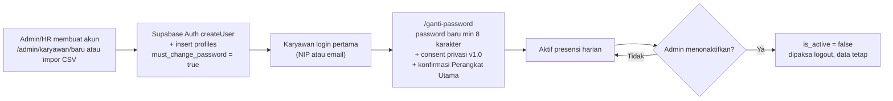
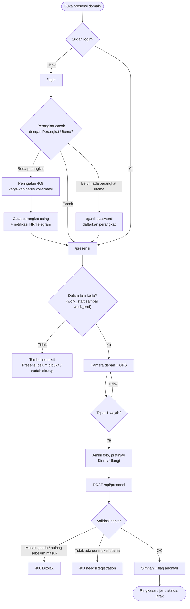

# Alur Bisnis

## Aktor dan Hak Akses (implementasi saat ini)

| Kemampuan | Administrator | Admin HR | Karyawan |
|---|:-:|:-:|:-:|
| Presensi, riwayat pribadi | Tidak | Tidak | Ya |
| Profil sendiri, ganti password | Ya | Ya | Ya |
| Dashboard backoffice | Ya | Ya | Tidak |
| Kelola karyawan, impor CSV, detail karyawan | Ya | Ya | Tidak |
| Laporan + ekspor Excel/PDF | Ya | Ya | Tidak |
| `/admin/akun` (ubah role, hapus akun, reset perangkat) | Ya | Tidak | Tidak |
| `/admin/pengaturan` (jam kerja, kantor, radius, libur, retensi) | Ya | Tidak | Tidak |
| `/admin/audit-log` | Ya | Tidak | Tidak |
| Menetapkan Administrator baru | Hanya lewat CLI `admin:rotate` | Tidak | Tidak |

Sumber aturan: `superAdminRoutes` dan `allowedPrefixes` di [`hooks.server.js`](../../src/hooks.server.js), serta pemeriksaan role di setiap action.

## Siklus Hidup Akun

- Tidak ada pendaftaran mandiri. Akun hanya dibuat oleh Administrator atau Admin HR.
- Jika insert profil gagal, user Auth yang sudah dibuat **dihapus kembali** (rollback manual) di [`karyawan/baru/+page.server.js`](../../src/routes/admin/karyawan/baru/+page.server.js).
- Role yang bisa dibuat dari UI hanya `admin_hr` dan `karyawan`.

## Alur Presensi Harian

## Aturan Status

Parameter dibaca dari tabel `settings` (satu baris, `id = 1`). Nilai awal: masuk 08:00, pulang 16:00, toleransi 0 menit, radius 100 m, retensi foto 30 hari.

| Status / penanda | Kapan | Disimpan sebagai |
|---|---|---|
| **Tepat Waktu** | menit sekarang ≤ `work_start + late_tolerance_min` | `status = 'tepat_waktu'` |
| **Terlambat** | menit sekarang > `work_start + toleransi` | `status = 'terlambat'`, `late_minutes = sekarang - work_start` |
| **Pulang Cepat** | presensi pulang sebelum `work_end` | `early_leave_minutes = work_end - sekarang` |
| **Di luar radius** | `distance_m > radius` (radius milik karyawan atau kantor) | dihitung saat menampilkan dashboard/laporan |
| **Lokasi mencurigakan** | mock GPS, akurasi < 1,5 m, selisih timestamp > 30 detik | `is_suspicious_location = true`, `location_flags[]` |
| **Perangkat asing** | `device_id` bukan perangkat utama | `is_unrecognized_device = true`, flag `unrecognized_device` |
| **Tidak Hadir** | enum dan constraint sudah tersedia di DB | `status = 'tidak_hadir'` (lihat catatan) |

Contoh perhitungan (toleransi 0): presensi 08:00 tercatat Tepat Waktu, 08:01 tercatat Terlambat 1 menit. Presensi pulang 15:30 tercatat Pulang Cepat 30 menit.

**Aturan integritas yang dijaga database** ([`initial_schema.sql`](../../supabase/migrations/20261007000100_initial_schema.sql)):
- `unique (user_id, work_date)`: satu baris per hari.
- `check_out_at >= check_in_at`.
- `tidak_hadir` berarti tidak ada jam masuk dan pulang. `tepat_waktu/terlambat` wajib punya jam masuk.
- Koreksi manual (`is_manual_correction`) wajib punya `note` (alasan).
- Koordinat harus valid (lat -90..90, lng -180..180), dan akurasi/jarak tidak boleh negatif.

## Catatan Jujur (berguna jika ditanya)

- **Otomasi "Tidak Hadir" / "Lupa Pulang" (pg_cron) belum diimplementasikan.** Enum `tidak_hadir`, kolom `missing_checkout`, dan setting `photo_retention_days` sudah ada, tetapi belum ada job terjadwal di repo. Fitur ini masuk roadmap PRD Fase 10.
- **Batas jam presensi hanya dicek di UI.** Tombol presensi nonaktif di luar `work_start` sampai `work_end`. Akibatnya, presensi masuk sebelum 08:00 tidak bisa dilakukan, dan "Tepat Waktu" hanya terjadi tepat pada menit jam masuk (atau dalam toleransi). Endpoint server belum menolak presensi di luar jam kerja.
- **Validasi ukuran/tipe foto** di server (PRD: maks 200 KB, JPEG) dan **rate limiting** belum ada di endpoint. Yang sudah ada: bucket hanya menerima `image/jpeg` dan `BODY_SIZE_LIMIT` 10 MB.
- Koreksi manual presensi oleh admin belum memiliki UI khusus, meskipun kolom dan constraint-nya sudah ada.
