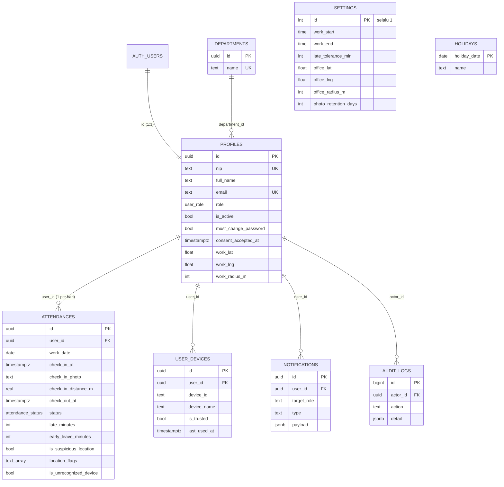
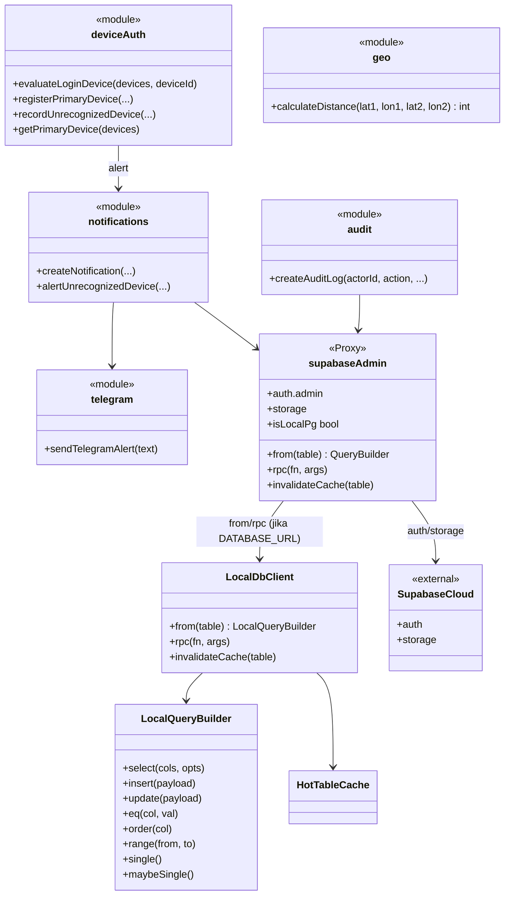

# Class Diagram

Proyek ini memakai JavaScript fungsional (tanpa banyak class), jadi diagram dibagi dua: **model data (ERD)** yang menjadi pusat sistem, dan **modul server** beserta fungsi publiknya.

## Model Data

## Modul Server

## Catatan

- `attendance_status` = `tepat_waktu | terlambat | tidak_hadir`. "Pulang cepat" bukan status tersendiri, tetapi `early_leave_minutes > 0`.
- `user_role` = `administrator | pemilik (legacy) | admin_hr | karyawan`.
