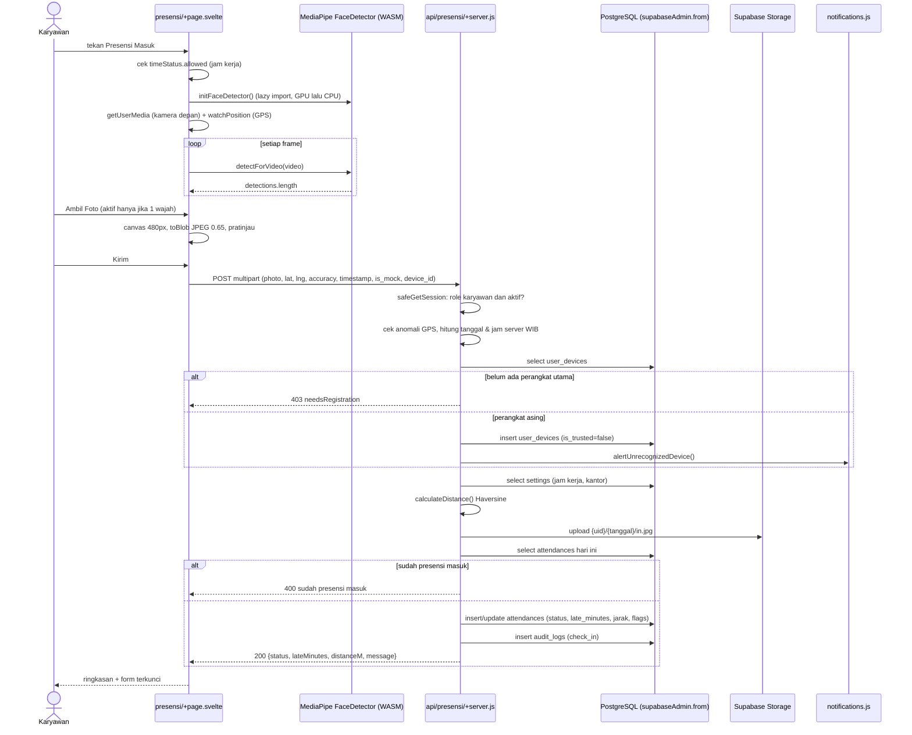
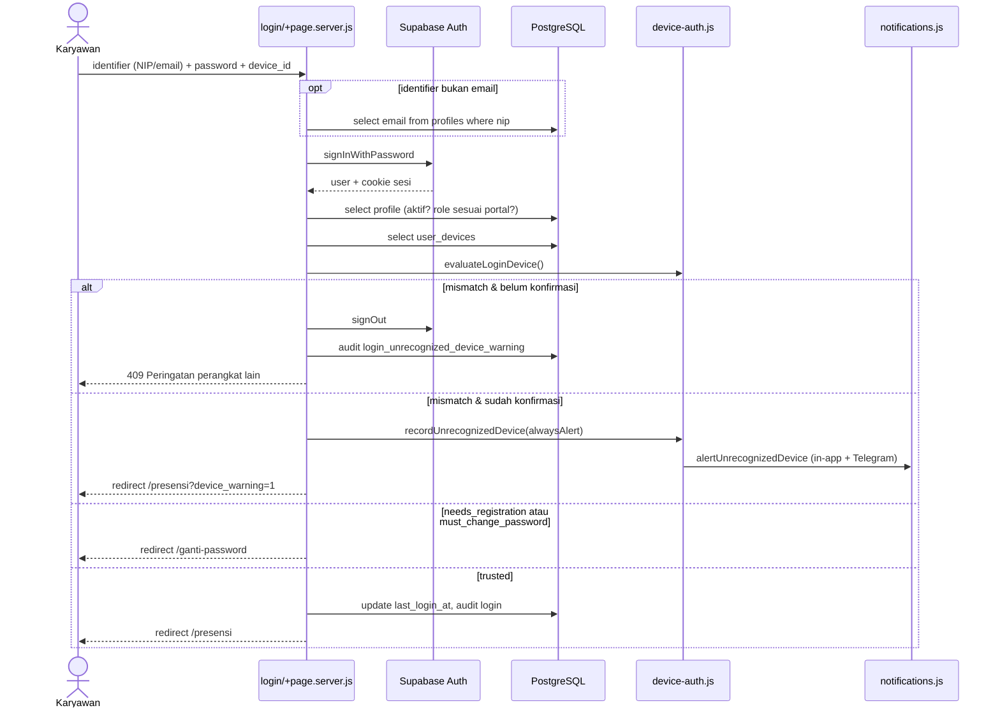
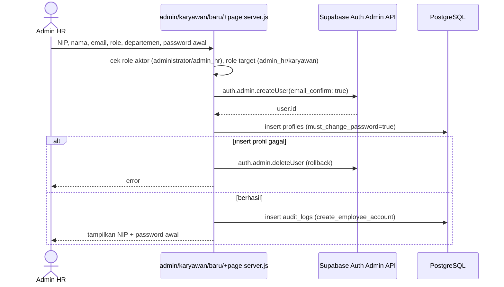
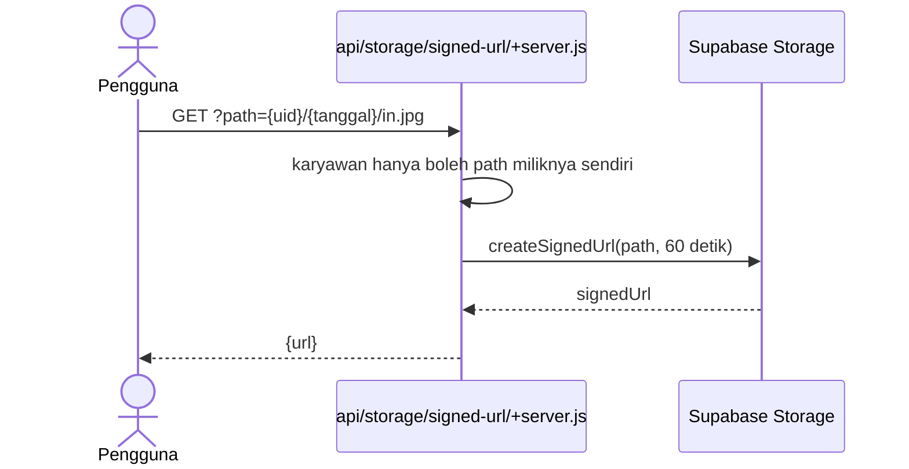

# Sequence Diagram

## Alur: Presensi Masuk

Karyawan menekan "Presensi Masuk" di `/presensi` selama jam kerja.

### Walkthrough

1. **Validasi jam kerja & kamera**: `startAttendanceFlow()` di [`presensi/+page.svelte`](../../../src/routes/presensi/+page.svelte).
2. **Deteksi wajah**: `detectFaces()` dengan `requestAnimationFrame`.
3. **Kompresi**: `capturePhoto()`.
4. **Pengiriman**: `submitAttendance()`.
5. **Pencatatan**: `POST` di [`api/presensi/+server.js`](../../../src/routes/api/presensi/+server.js).

## Alur: Login Karyawan + Verifikasi Perangkat

### Walkthrough

1. **Terjemahan NIP ke email, lalu login**: [`login/+page.server.js`](../../../src/routes/login/+page.server.js).
2. **Evaluasi perangkat**: `evaluateLoginDevice()` di [`device-auth.js`](../../../src/lib/server/device-auth.js).

## Alur: Pembuatan Akun Karyawan oleh HR

## Alur: Melihat Foto Presensi (Signed URL)

